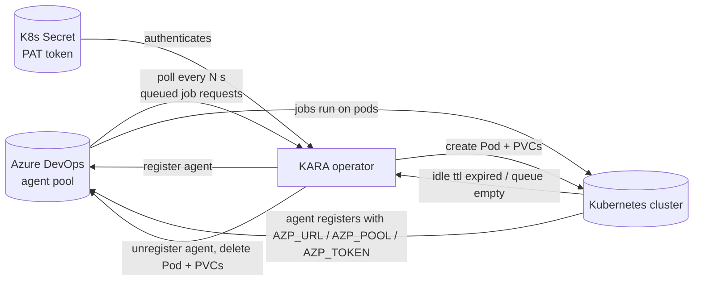

# KARA

KARA (Kubernetes Azure Runner Autoscaler) is a Kubernetes operator that scales Azure DevOps self-hosted agent pools on demand. You point it at an agent pool, and KARA watches the pool's job queue. When jobs are waiting, it registers new agents backed by pods in your cluster. When the queue empties, the agents unregister and the pods are deleted.

You do not manage VMs, node pools or a static fleet of runners. If you keep a minimum number of agents, they stay warm so the first job does not wait for a cold start. Otherwise the pool scales to zero.

## What you get

| Feature | What it does |
|---|---|
| **Autoscaling on demand** | Polls the pool's queued job requests and spawns agent pods to cover the queue, up to `maxAgents`. |
| **Minimum agents** | Keeps `minAgents` agents warm at all times, so pipelines do not wait for a cold start. |
| **Capability-aware scaling** | Jobs with demands (for example a Docker image) only scale agents whose image carries that capability. |
| **Idle scale-down** | Agents that finish their work and stay idle for `ttlIdleSeconds` are unregistered and their pods removed. |
| **Completed-job retention** | Freshly completed pods are kept for the idle window so follow-up jobs and log collection can use them. |
| **Structured storage** | Optional PVCs per agent (created, owned and cleaned up by KARA), with an init container that fixes permissions. |
| **One-shot agents** | With `ttlIdleSeconds: 0`, non-minimum agents run `--once` and unregister themselves when idle. |
| **Safe deletion** | Deleting a `RunnerPool` unregisters every KARA-managed agent from the pool and deletes its pods and PVCs. |
| **Admission webhooks** | A mutating webhook defaults sensible values; a validating webhook enforces the invariants. |
| **Rich status** | Queue depth, agent counts, per-index mapping, conditions and last error, all on the resource. |
| **Metrics** | Prometheus metrics behind authenticated, TLS-protected endpoint. |

## How it works

1. You create a **RunnerPool** that points at an Azure DevOps organization and pool, with a Secret holding a PAT.
2. KARA connects to the organization and resolves the pool.
3. Every `pollIntervalSeconds` it reads the pool's **queued job requests** and the list of agents.
4. If there are more queued jobs than capacity, KARA creates agent pods (and PVCs, if configured). Each pod runs the Azure DevOps agent and registers itself with the pool using the PAT.
5. When a job finishes and the agent stays idle for `ttlIdleSeconds`, KARA unregisters it and deletes the pod and its PVCs.
6. Deleting the RunnerPool unregisters all KARA-managed agents and cleans up all pods and PVCs.

You only create the `RunnerPool`. KARA creates and tears down the agents.

## Where to start

- [Prerequisites](getting-started/prerequisites.md): what your cluster and your Azure DevOps org need.
- [Installation](getting-started/installation.md): install the operator with Kustomize or Helm.
- [Quickstart](getting-started/quickstart.md): scale your first pool in five minutes.
- [RunnerPool](resources/runnerpool.md): the resource reference, field by field.
- [Helm chart](helm/kara.md): every chart setting.
- [Troubleshooting](reference/troubleshooting.md): what to do when something fails.

## API at a glance

KARA manages one resource, in the API group `kara.felukka.org/v1`, namespaced.

| Kind | Plural | Created by |
|---|---|---|
| `RunnerPool` | `runnerpools.kara.felukka.org` | You |

Agent pods, PVCs and the Azure DevOps agents themselves are created by KARA.
